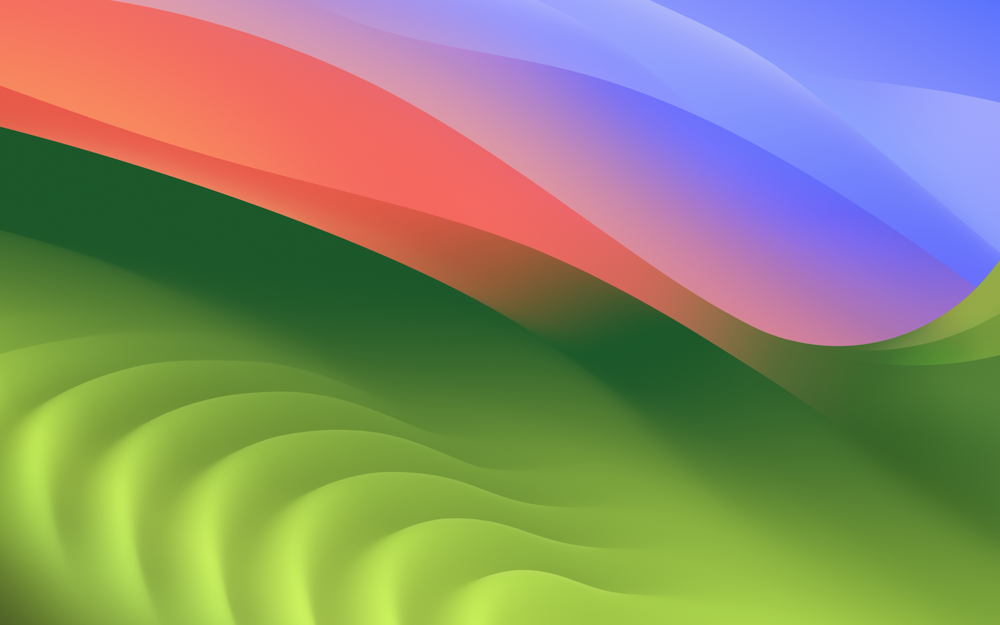
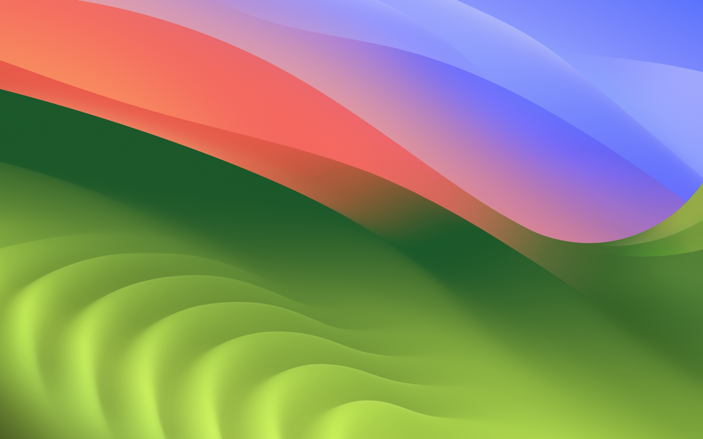
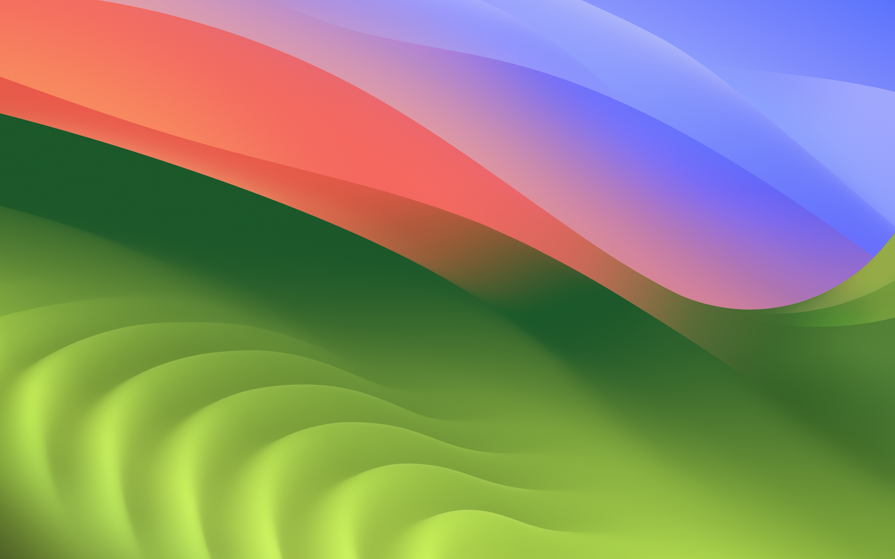
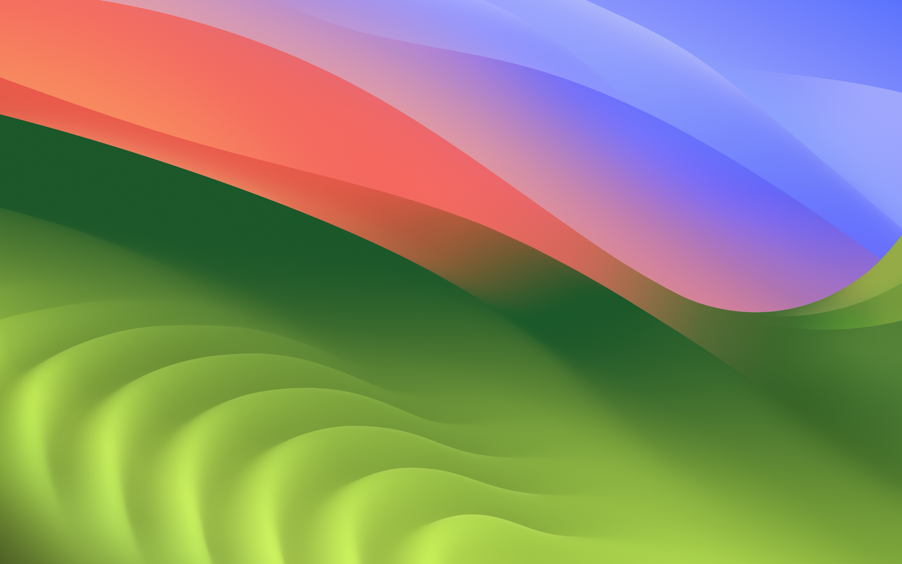

# Habit Tracker

**Habit Tracker** — браузерное веб-приложение для планирования привычек и отслеживания регулярности их выполнения. Пользователь может вести список привычек, отмечать их выполнение по дням недели и анализировать собственный прогресс.



## Возможности

- Добавление, редактирование и удаление привычек
- Настройка названия, описания и цвета привычки
- Отметки выполнения по дням недели
- Блокировка отметок для будущих дней
- Переключение между неделями и переход к текущей неделе
- Фильтры «Все», «Активные» и «Выполнено сегодня»
- Статистика выполнения за день и за неделю
- Расчёт текущей и рекордной серии
- Визуализация недельного прогресса (кольцо, сегментированная полоса и легенда)
- Сохранение данных между перезагрузками страницы
- Синхронизация данных между вкладками одного браузера
- Адаптивный интерфейс и пустые состояния

## Скриншоты

| Секция | Скриншот |
|---|---|
| Прогресс недели с кольцом, сегментированной полосой и легендой |  |
| Модальное окно добавления привычки |  |
| Недельная сетка с отметками и навигацией между неделями |  |
| Мобильная версия (375–390 px), с плавающей кнопкой добавления |  |
| Пустое состояние |  |

## Технологии

- HTML5
- CSS3
- Vanilla JavaScript (ES6+)
- localStorage
- StorageEvent и DOM API
- встроенные SVG

Приложение работает исключительно в браузере, без backend, сборщика и внешних JavaScript-зависимостей.

## Запуск

Для локального предпросмотра используется статический сервер. В корне проекта выполните:

```bash
python3 -m http.server 8000
```

Затем откройте в браузере: [http://localhost:8000](http://localhost:8000).

Сборка проекта не требуется.

## Хранение данных и ограничения

- **Место хранения:** данные сохраняются в `localStorage` браузера под ключом `habit-tracker:v1`.
- **Только в браузере:** данные не отправляются на сервер.
- **Синхронизация внутри браузера:** изменение данных в одной вкладке автоматически отображается в других вкладках того же браузера через событие `StorageEvent`. Синхронизация между разными устройствами не поддерживается.
- **Ограничения localStorage:** при недоступности хранилища (приватный режим, блокировка хранилища, настройки браузера) изменения не будут сохраняться.
- **Резервное копирование:** не реализовано. Данные могут быть потеряны при очистке локальных данных браузера (кэша и localStorage).
- **Формат:** отметки хранятся только за те дни, когда привычка была выполнена. При загрузке данные нормализуются.

## Статус проекта

Клиентское веб-приложение для личного учёта привычек. Разработано в учебно-демонстрационных целях.